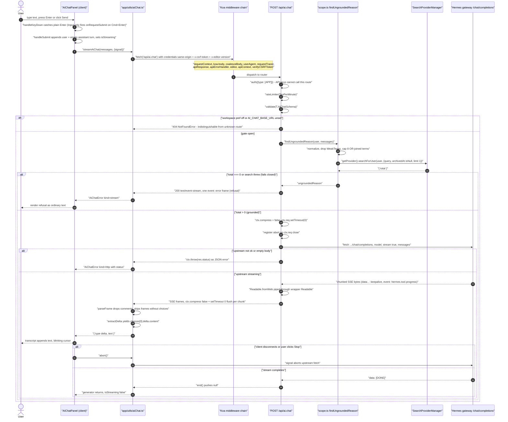
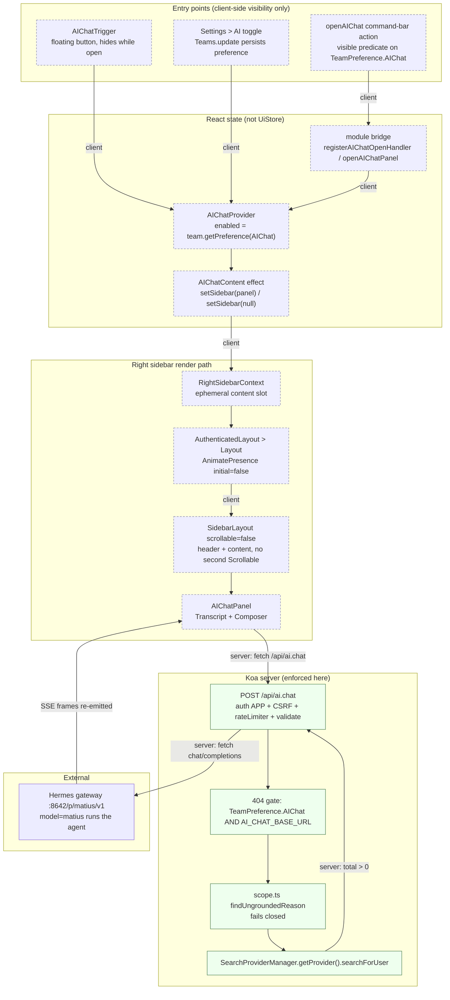

# AI Chat — System Design

Architecture for the workspace-gated AI chat panel: how a keystroke in the
right sidebar becomes a streamed answer from the Hermes gateway, how the
knowledge-base boundary is enforced, and what happens when any of it fails.

For how to *run and use* the feature — env vars, the settings toggle, curl
recipes — see [docs/AI-CHAT.md](./AI-CHAT.md). That document is the operational
guide; this one is the design.

## 1. Scope and shape

The feature is a **read-only streaming proxy plus a retrieval gate**:

- **Server** — `POST /api/ai.chat` (`server/routes/api/ai/ai.ts`) validates the
  conversation, decides whether the workspace knowledge base can ground it, then
  proxies `${AI_CHAT_BASE_URL}/chat/completions` with `stream: true` and
  re-emits the upstream byte stream to the browser as Server-Sent Events.
- **Client** — `app/utils/aiChat.ts` opens the request with a raw `fetch`
  (bypassing `ApiClient`) and yields incremental text deltas; `AIChatPanel`
  renders them into the right sidebar.
- **Persistence** — none. The route calls no `server/commands/` write path and
  stores nothing. The transaction log is the provider's, not Outline's.

The one database read on the path is the grounding probe (§4). Before the
grounding gate existed this route performed **no** DB read at all.

## 2. Request flow

Diagram A traces a single send from keystroke to incremental token, including
the two `alt` branches the transport can take: a refusal and an upstream error.



### 2.1 Middleware chain

The route is mounted by `server/routes/api/index.ts`, whose chain is registered
before any domain router:

```
requestContext → koa-body → cleanupMultipartFiles → coalesceBody → userAgent
→ requestTracer → apiResponse → apiErrorHandler → editor → apiContext
→ verifyCSRFToken → plugin Hook.API routes → ai routes
```

Per-route the stack is `auth({ type: [AuthenticationType.APP] })` →
`rateLimiter(RateLimiterStrategy.TenPerMinute)` → `validate(T.AiChatSchema)`.

- **API keys cannot call this route.** `AuthenticationType.APP` admits
  session/bearer authentication only, so the scoped MCP credentials in
  `docs/HERMES-OUTLINE-ARCHITECTURE.md` have no path here.
- **CSRF is enforced for cookie transport.** `verifyCSRFToken()` skips requests
  whose transport is not `cookie`, and skips anything callable with
  `Scope.Read`. `POST /api/ai.chat` is not, so a cookie-authenticated request
  must carry `x-csrf-token` matching the CSRF cookie. `streamAiChat` attaches it
  manually from `getCSRFToken()`.

### 2.2 Body shape

`validate(T.AiChatSchema)` requires `{ messages: [{ role, content }] }` — **not**
`{ prompt }`. The array holds 1–50 messages (`AiChatMaxMessages`), each
`content` 1–8000 characters (`AiChatMaxMessageLength`), and `role` is restricted
to `user` or `assistant`: the `system` role is rejected at the schema so a
caller cannot inject server-side instructions.

## 3. Streaming transport

The response is SSE, and three details make it work:

- **`ctx.compress = false`** before anything is written. `koa-compress` treats
  `text/event-stream` as compressible and would otherwise buffer, defeating
  incremental delivery.
- **`ctx.req.setTimeout(0)`** clears the per-request socket timeout, which
  would otherwise cut a slow first token.
- **`setTimeout(0)` / writer discipline.** `ctx.body` is a hand-rolled
  `Readable` and the only writer on the socket; koa pipes it to `ctx.res`. A
  second writer would interleave frames, so the wrapper interposes a mid-stream
  error *into* that same stream rather than throwing.

No `timeout` option is passed to `fetch`, so undici's 300-second default
applies. On client disconnect (`ctx.req.on("close")`) an `AbortController`
aborts the upstream request, so an abandoned browser tab does not pin a
provider connection.

### 3.1 Failure modes

| Failure | Mechanism | Client sees |
|---|---|---|
| Feature off / unset base URL | `throw NotFoundError()` | 404 JSON, `AiChatError kind=http status=404` |
| Prompt not grounded | in-band `event: error` frame, upstream never called | refusal rendered as ordinary transcript text |
| Upstream non-OK | `ctx.throw(res.status, "AI chat provider error")`; upstream detail logged only | JSON error status, `kind=http` |
| Upstream mid-stream error | `event: error` frame pushed into the same stream | `kind=stream`, provider message |
| Transport failure / abort | `fetch` rejects or reader rejects | `kind=network` |
| Unparseable frame | `JSON.parse` throws in `parseFrame` | `kind=malformed` |

Upstream failure is deliberately **in-band**: if the provider dies after the
first token, the browser already holds a 200 `text/event-stream`, and replaying
a status is impossible. A frame on the same channel is the only lossless option.

### 3.2 Why the client needed no rewrite

The upstream interleaves two frame kinds the client does not want: `: keepalive`
comments and `event: hermes.tool.progress`. `parseFrame` iterates only lines
starting with `event:` or `data:` — comments produce `dataLines.length === 0`
and are dropped — and `extractDelta` returns `""` for any frame without
`choices[0].delta.content`. Frames split across `read()` boundaries are buffered
until the `\n\n` terminator arrives, so punctuation mid-frame cannot corrupt
accumulation.

## 4. The KB boundary, rebuilt three times

The whole arc of this work is the boundary between "this workspace's knowledge
base" and "the model's parametric memory." It was built three ways, each
strictly stronger than the last.

### Stage 1 — Prompt text only (not a boundary)

The Hermes profile carried the constraint as prose: the `SOUL.md` persona plus
the workspace's `guidanceMCP`, delivered over the MCP handshake (see
`docs/HERMES-OUTLINE-ARCHITECTURE.md` §4). The toolset allowlist
(`platform_toolsets`) removed every non-KB tool, so the agent had *no path* to
answer off-topic questions with a tool.

It still answered them from memory. Measured: `"What is the capital of France?"`
returned `"Paris."` in roughly 40% of samples. Prompt text is a preference, not
a constraint — the model can always answer from weights it already holds, and
the toolset allowlist cannot prevent that. **Stage 1 is not a boundary.**

### Stage 2 — Phrase denylist (partial)

A denylist of **16 parametric-memory shapes** matched by regex. Each pattern ran
through NFKC normalization, zero-width-character stripping, and a *dual* regex
(a spacing variant and a compact variant) so `"what is the capital"` and
`"whatisthecapital"` both matched.

It caught the common cases and nothing else. Every paraphrase, every spelling
the author had not anticipated, and every language other than English walked
through. A denylist is bounded by the imagination of whoever wrote it; the space
of off-topic questions is not.

### Stage 3 — Retrieval grounding (current)

The boundary became structural: `findUngroundedReason(user, messages)` in
`server/routes/api/ai/scope.ts`.

1. `promptText` keeps **only `user` messages**, newest first — an assistant
   echo must not lock a conversation, and a follow-up should spend the term
   budget on the current topic.
2. `normalize` applies NFKC, strips zero-width and soft-hyphen characters,
   lowercases, and replaces everything that is not a letter or digit with a
   space, so no punctuation can survive inside a search term (which also makes
   the later string interpolation `tsquery`-safe).
3. `buildProbeQuery` drops words shorter than 2 characters, drops `WeakTerms`
   (a small set of English function words and conversational filler), drops
   duplicates, and caps the query at **8 terms** (`MaxProbeTerms`), joined with
   `|` — the provider's OR operator. Left unquoted, `pg-tsquery` would AND the
   words and match nothing; quoting is worse, because the provider lifts quoted
   fragments into AND-ed clauses and keeps only the first three.
4. The probe calls `SearchProviderManager.getProvider().searchForUser(user, {
   query, filter: { field: "archivedAt", operator: "isNull" }, offset: 0,
   limit: 1 })` and **`total > 0` decides**.

Two properties are load-bearing:

- **Authorization is the search provider's.** `searchForUser` narrows to
  documents the user can read by membership and collection access. A prompt
  whose only match sits in an unreadable collection returns nothing and is
  refused, so the endpoint cannot be used to probe for inaccessible documents.
- **It fails closed.** If retrieval throws, the prompt is refused ("search
  failed") rather than passed through ungrounded.

Archived documents are excluded from the probe: the assistant cannot open one,
so an archived-only match would approve the prompt only to have the model refuse
it after the upstream latency.

### 4.1 The ceiling, stated plainly

- A lexical hit is a **claim**, not a **measurement**. `total > 0` says a
  document shared a word with the prompt, not that the workspace can answer it.
- **No false-reject rate has been measured against the live corpus.** The
  refusal rate on real traffic is unknown.
- A full-text OR **over-matches** a document that merely shares a common word
  and **under-matches** a paraphrase that shares none. Both directions are known
  and unquantified.
- The gate is **deliberately biased toward refusing**, because a refusal is
  visible to the user and a hallucination is not. A false rejection costs one
  retry; a false acceptance is an ungrounded answer presented as a citation.

Cost: one search per request (two or three indexed queries on the read
replica), on a route that previously did no database read. The upgrade path, if
this proves too blunt, is ranking with embeddings, or keeping the lexical probe
and adding a post-hoc check that the upstream stream cites a `/doc/` URL before
any token of it is flushed.

## 5. Components

Diagram B shows the client and server layers and how a click reaches the panel.
Edges are marked **server** when the boundary is enforced in Koa and **client**
when it is only a UI predicate.



**Server-enforced edges** (a request cannot cross them without satisfying the
check): `Gate` on `TeamPreference.AIChat` + `AI_CHAT_BASE_URL`, `auth({type:
[APP]})`, CSRF, the rate limiter, the zod schema, and the grounding probe. A
client that skips every UI predicate still hits these.

**Client-only edges** (visibility, not security): the trigger rendering, the
command-bar `visible` predicate, and the provider withholding its controls when
the preference is off. They exist so the UI does not offer a door the server
will not open; they enforce nothing.

## 6. Design constraints the bugs paid for

These are not trivia — each one is a trap a future change will re-enter.

### 6.1 The composer was clipped

`SidebarLayout` defaults `scrollable = true` and wraps its children in a
`Scrollable`. `AIChatPanel` already provides its own scroller (`Transcript`), so
the panel was nested inside a second `Scrollable`, and `Transcript` had `flex: 1`
without `min-height: 0` — a flex item defaults to `min-height: auto` and will not
shrink below its content. The transcript grew unbounded and pushed the composer
past `Container`'s `overflow: hidden`.

Fixed with `scrollable={false}` on `SidebarLayout` plus `min-height: 0` on
`Container` and `Transcript`.

### 6.2 The Send button was visible but unclickable

`Input`'s root `Wrapper` carries `flex: 0`, i.e. `flex-basis: 0%` — **zero
height** in a column. The `position: relative` inner textarea painted over the
Send button, so `document.elementFromPoint` returned `TEXTAREA` and trusted
clicks were intercepted. `el.click()` still worked, which is exactly why the
unit tests passed while a human could not press the button.

Fixed with `Composer > * { flex: 0 0 auto }`. When the composer became a **row**
the same trap re-appeared as zero **width**, requiring
`Composer > :first-child { flex: 1 1 auto; min-width: 0 }` — `0` rather than
`initial`, because `Wrapper` sets `min-width: initial`, the flex-item automatic
minimum size, which forbids the shrink.

### 6.3 The floating trigger

`AIChatTrigger` renders only when the preference is on and the panel is closed,
and positions itself `position: fixed` at `z-index: depths.sidebar - 1` (899),
just below the sliding `Aside` (900), so it sits under the panel rather than
over it.

### 6.4 Enter sends

`Input` fires `onRequestSubmit` only on **Cmd+Enter** (`Input.tsx`
`handleKeyDown` returns early on the meta branch). The panel handles plain
`Enter` locally in its own `onKeyDown`, calling `preventDefault()` and
`requestSubmit()`. The `preventDefault` is not optional: without it the browser
would implicitly submit the form a second time.

### 6.5 The vacuous test

The `Button` mock in the trigger test hardcoded the CSS under test, so the
assertion passed regardless of the component. The mock now forwards `style`
verbatim; removing `style` from the trigger fails the suite with
`expected '' to be 'fixed'`.

## 7. The routing fact that cost the most time

Within the profile-scoped URL `http://127.0.0.1:8642/p/matius/v1`, the **`model`
field selects the behaviour** — not the path, not the key.

- **`model=matius`** runs the agent: persona, KB tools, MCP guidance, the
  toolset allowlist. This is the AI chat feature.
- **`model=ski-bot`** is a bare model passthrough: no persona, no KB, no tools.

Same URL, same API key, completely different behaviour. The profile path scopes
*which profiles the gateway will serve*; the `model` string selects *what runs
inside the profile*. Changing one without knowing this looks like the boundary
randomly stopped working.

## 8. Honesty notes and verification status

- **The panel has never been rendered in a browser.** Browser automation is
  unavailable on this host (`Windows named-pipe discovery is not implemented`).
  No screenshot exists. Every claim about layout and clickability above is from
  reading the code and the CSS, and is stated as such.
- **Streaming was proven by a real authenticated round trip** through
  `POST /api/ai.chat` using a Bearer session JWT: 200 `text/event-stream`, 184 ms
  to the first frame, 287 incremental deltas, a clean `[DONE]`, 102 s total for a
  KB question. The panel's cookie + CSRF path was verified by **code reading
  only**.
- **CI does not run on this fork.** Despite workflow files and
  `actions/permissions.enabled: true`, there are 0 check-runs and 0 workflow
  runs. All verification is local.
- Nothing in this document was inferred from a provider dashboard or an
  external service; every edge in Diagram B corresponds to an import, a call, or
  a context provider in the repository.

## 9. Configuration

Referenced by name only — values live in the environment, never in this
document.

| Variable | Notes |
|---|---|
| `AI_CHAT_BASE_URL` | `@Public`, `@IsUrl` (http/https). Appends `/chat/completions`. Unset disables the feature. |
| `AI_CHAT_API_KEY` | **Secret.** Deliberately **not** `@Public`, so it never serializes to the client. |
| `AI_CHAT_MODEL` | Forwarded as `model` in the upstream body (§7). |

All three are `@CannotUseWithout("AI_CHAT_BASE_URL")`, so setting the key or the
model without the base URL is rejected at boot. The feature **fails soft**: an
unset configuration is a safe no-op, not a broken server.

Local verification used `AI_CHAT_BASE_URL=http://127.0.0.1:8642/p/matius/v1` and
`AI_CHAT_MODEL=matius` against the Hermes gateway.
