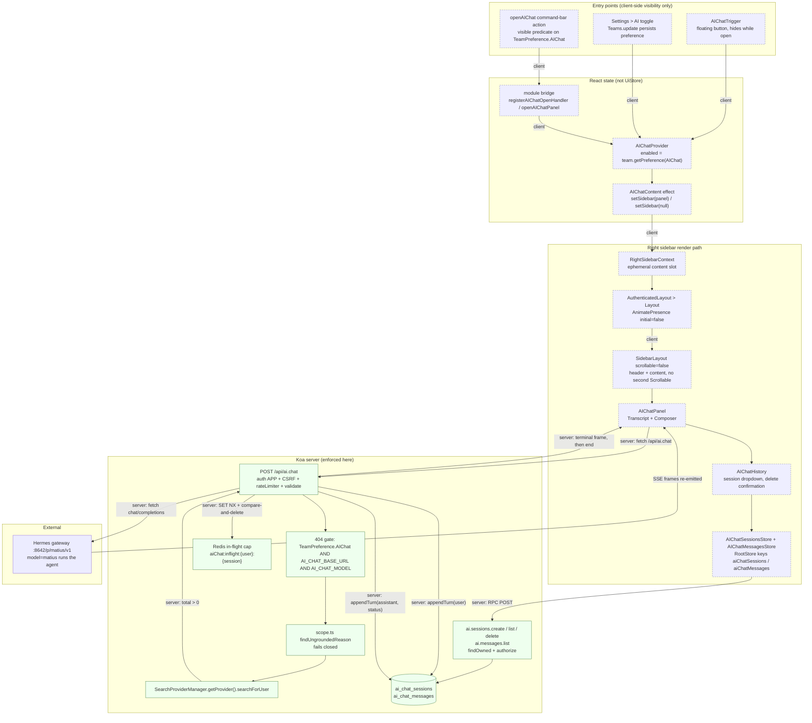

# AI Chat — System Design

Architecture for the workspace-gated AI chat panel: how a keystroke in the
right sidebar becomes a streamed answer from the Hermes gateway, how the
knowledge-base boundary is enforced, where the conversation is stored, and what
happens when any of it fails.

For how to *run and use* the feature — env vars, the settings toggle, curl
recipes — see [docs/AI-CHAT.md](./AI-CHAT.md). That document is the operational
guide; this one is the design.

## 1. Scope and shape

The feature is a **streaming proxy, a retrieval gate, and a server-authoritative
session store**:

- **Server** — `POST /api/ai.chat` (`server/routes/api/ai/ai.ts`) validates the
  conversation, decides whether the workspace knowledge base can ground it, then
  proxies `${AI_CHAT_BASE_URL}/chat/completions` with `stream: true` and
  re-emits the upstream byte stream to the browser as Server-Sent Events.
- **Client** — `app/utils/aiChat.ts` opens the request with a raw `fetch`
  (bypassing `ApiClient`) and yields incremental text deltas; `AIChatPanel`
  renders them into the right sidebar.
- **Persistence** — server-authoritative. Two tables carry the conversation:
  `ai_chat_sessions` (one row per conversation, owned by a `(teamId, userId)`
  pair) and `ai_chat_messages` (one row per turn, ordered by `seq`, carrying
  `role`, `content`, `status` and `runId`). When a request supplies a
  `sessionId`, the route appends the turn, streams the answer, and writes the
  terminal assistant row; when it does not, nothing is stored and the response
  is a pure byte proxy, byte-identical to the pre-turns wire format. Four RPC
  endpoints expose the model (`server/routes/api/ai/aiSessions.ts`):
  `ai.sessions.create`, `ai.sessions.list`, `ai.sessions.delete` and
  `ai.messages.list`. On the client, `AIChatSessionsStore` and
  `AIChatMessagesStore` (`app/stores/`) hold the same data and are the only
  thing the panel reads.

The database reads on the path are the ownership lookup, the upstream window
rebuild (§2.3), the grounding probe (§4), and — for a session-backed turn —
the `seq` allocation behind each write.

## 2. Request flow

Diagram A traces a single **session-backed** send from keystroke to the stored
answer: the ownership check, the per-session in-flight lock, the grounding
refusal branch, the three stream exits, and the server-authored terminal frame.
A stateless send (`messages` with no `sessionId`) takes the same path with every
storage step short-circuited — no row, no lock, no terminal frame.

```mermaid
sequenceDiagram
autonumber
actor User
participant Panel as "AIChatPanel (client)"
participant Util as "app/utils/aiChat.ts"
participant MW as "Koa middleware chain"
participant Route as "POST /api/ai.chat"
participant Store as "ai_chat_sessions / ai_chat_messages"
participant Scope as "scope.ts findUngroundedReason"
participant Search as "SearchProviderManager"
participant Lock as "Redis aiChat:inflight:{user}:{session}"
participant Hermes as "Hermes gateway /chat/completions"

User->>Panel: type text, press Enter or click Send
Panel->>Panel: "handleKeyDown catches plain Enter (Input only fires onRequestSubmit on Cmd+Enter)"
Panel->>Panel: "handleSubmit appends user + empty assistant turn, sets isStreaming"
Panel->>Util: "streamAiChat(history, {signal, sessionId})"
Util->>MW: "fetch('/api/ai.chat') with credentials same-origin + x-csrf-token + x-editor-version"
Note over MW: "requestContext, koa-body, coalesceBody, userAgent, requestTracer,<br/>apiResponse, apiErrorHandler, editor, apiContext, verifyCSRFToken"
MW->>Route: dispatch to router
Route->>Route: "auth({type: [APP]}) - API keys cannot call this route"
Route->>Route: "rateLimiter(TenPerMinute)"
Route->>Route: "validate(T.AiChatSchema)"
alt "workspace pref off, AI_CHAT_BASE_URL unset, or AI_CHAT_MODEL unset"
Route-->>Util: "404 NotFoundError - indistinguishable from unknown route"
else gate open
Route->>Route: "runId = uuidv4(), stamped on both rows of the turn"
Route->>Route: "AIChatSession.findOwned(sessionId, user)"
alt "sessionId present but not owned (or absent)"
Route-->>Util: "404 NotFoundError as JSON, before any write or stream"
else ownedSession (or stateless: sessionId absent)
Route->>Lock: "SET aiChat:inflight:{user}:{session} = runId EX 300 NX"
alt "lock not acquired - a turn is already streaming"
Route-->>Util: "200 SSE, one event: error frame, kind=busy"
Util-->>Panel: "AiChatError kind=busy"
Panel-->>User: render 'another answer is still being generated'
else acquired
Route->>Store: "appendTurn(user, content, completed) when the newest client message is a user turn"
Note over Route,Store: "Written before the grounding gate, so a refusal is recoverable: reopening shows the question asked, not an orphan refusal"
Route->>Route: "resolveUpstreamMessages - window rebuilt from committed rows, capped to 50"
Route->>Scope: "findUngroundedReason(user, resolvedMessages)"
Scope->>Scope: "normalize, drop WeakTerms, cap 8 OR-joined terms"
Scope->>Search: "getProvider().searchForUser(user, {query, archivedAt isNull, limit 1})"
Search-->>Scope: "{ total }"
alt "total === 0 or search threw (fails closed)"
Scope-->>Route: "ungroundedReason"
Route->>Store: "appendTurn(assistant, refusal string, completed) - locale frozen at send time"
Route-->>Util: "200 SSE, one event: error frame (kind=refusal)"
Route->>Lock: "compare-and-delete release"
Util-->>Panel: "AiChatError kind=refusal"
Panel-->>User: render refusal as ordinary text
else "total > 0 (grounded)"
Route->>Route: "ctx.compress = false, ctx.req.setTimeout(0)"
Route->>Route: "register abort on ctx.res close"
Route->>Hermes: "fetch .../chat/completions, model, stream true, messages"
alt "upstream not ok or empty body"
Route-->>Util: "ctx.throw(res.status) as JSON error"
Route->>Lock: "compare-and-delete release"
Util-->>Panel: "AiChatError kind=http with status"
else "upstream streaming"
Hermes-->>Route: "chunked SSE bytes (data:, : keepalive, event: hermes.tool.progress)"
Route->>Route: "inspectChunk accumulates assistantText + lastFinishReason"
Route->>Route: "Readable.fromWeb piped through wrapper Readable"
Route-->>Util: "SSE frames, ctx.compress false + setTimeout 0 flush per chunk"
Util->>Util: "parseFrame drops comments, skips frames without choices"
Util->>Util: "extractDelta yields choices[0].delta.content"
Util-->>Panel: "{ type delta, text }"
Panel-->>User: transcript appends text, blinking cursor
alt "client disconnects or user clicks Stop"
Panel->>Util: "abort()"
Util->>Hermes: "signal aborts upstream fetch"
Route->>Route: "finish(aborted)"
else "upstream mid-stream error"
Route-->>Util: "event: error frame pushed into the same stream"
Util-->>Panel: "AiChatError kind=stream"
Route->>Route: "finish(aborted if clientGone else error)"
else "stream completes"
Hermes-->>Route: "last frame carrying finish_reason (data: [DONE] is consumed by the SDK, never forwarded)"
Route->>Route: "finish(completed if lastFinishReason else truncated)"
end
Route->>Route: "author terminal frame {runId, finishReason} as event: complete | truncated"
Route->>Store: "appendTurn(assistant, assistantText, status) in its own transaction"
Route->>Lock: "compare-and-delete release, then end()"
Route-->>Util: "terminal frame"
Util-->>Panel: "generator returns; a session-backed turn without the frame raises kind=truncated"
end
end
end
end
```

### 2.0.1 What the diagram asserts that the old one did not

- **Storage is server-authoritative.** The upstream window is rebuilt from
  committed rows (`resolveUpstreamMessages`), never from the client array, once
  a `sessionId` is present. A client cannot rewrite history by replaying a
  different `messages` array alongside a session id.
- **The terminal frame is authored here.** `finish()` writes
  `event: complete` or `event: truncated` with `{ runId, finishReason }`. It is
  never derived from `data: [DONE]` — the OpenAI SDK consumes that sentinel and
  does not forward it, so nothing downstream can rely on seeing it. See §3.3.
- **The busy refusal is in-band.** A second turn on the same session gets a
  200 `text/event-stream` carrying one `event: error` frame with
  `kind: "busy"`, not a bare status. The client is already expecting a stream
  from this endpoint and has no frame to attach the message to otherwise.
- **Every exit releases the lock**, including the two that return before a
  stream exists (`refusal` and the provider-unreachable `throw`).

### 2.1 Middleware chain

The route is mounted by `server/routes/api/index.ts`, whose chain is registered
before any domain router:

```
requestContext → koa-body → cleanupMultipartFiles → coalesceBody → userAgent
→ requestTracer → apiResponse → apiErrorHandler → editor → apiContext
→ verifyCSRFToken → plugin Hook.API routes → ai routes
```

Per-route the stack is `auth({ type: [AuthenticationType.APP] })` →
`rateLimiter(RateLimiterStrategy.TenPerMinute)` → `validate(T.AiChatSchema)`.

- **API keys cannot call this route.** `AuthenticationType.APP` admits
  session/bearer authentication only, so the scoped MCP credentials in
  `docs/HERMES-OUTLINE-ARCHITECTURE.md` have no path here.
- **CSRF is enforced for cookie transport.** `verifyCSRFToken()` skips requests
  whose transport is not `cookie`, and skips anything callable with
  `Scope.Read`. `POST /api/ai.chat` is not, so a cookie-authenticated request
  must carry `x-csrf-token` matching the CSRF cookie. `streamAiChat` attaches it
  manually from `getCSRFToken()`.

### 2.2 Body shape

`validate(T.AiChatSchema)` accepts **either** `{ messages: [{ role, content }] }`
— **not** `{ prompt }` — **or** `{ sessionId }`, and the two forms are mutually
exclusive in practice: a `.refine()` in `server/routes/api/ai/schema.ts` requires
at least one of the two, so `messages` is **optional when `sessionId` is present**
and required otherwise. When both are supplied, `messages` supplies only the
*new* turn; the window the provider sees is rebuilt from storage (§2.3).

Either way the array holds 1–50 messages (`AiChatMaxMessages`), each `content`
1–8000 characters (`AiChatMaxMessageLength`), and `role` is restricted to `user`
or `assistant`: the `system` role is rejected at the schema so a caller cannot
inject server-side instructions. `sessionId` is a `z.uuid()`.

### 2.3 The upstream window is rebuilt from storage

`resolveUpstreamMessages` (`server/routes/api/ai/ai.ts`) is what makes the store
authoritative rather than advisory:

- **No `sessionId`** — the schema has already guaranteed `messages`, so the
  client array is the whole conversation and nothing is read or written.
- **With a `sessionId`** — ownership is resolved first, then the rows are read
  in `seq ASC` order and reduced by `toUpstreamMessages`, which keeps only
  `role` and `content` (dropping `seq`, `status`, `runId`, `sessionId`,
  `teamId`, `userId`) and slices to the most recent `AiChatMaxMessages`. The
  allow-list is **re-asserted at runtime** on every row rather than trusted from
  the column type, so a stored role outside the provider's set cannot be
  forwarded.

Because ownership is checked before the read, a session belonging to another
user raises `NotFoundError` **without loading a single row**, and before the
response is a stream — so a non-owned id is a normal JSON 404, never a 200 that
carries SSE.

## 3. Streaming transport

The response is SSE, and three details make it work:

- **`ctx.compress = false`** before anything is written. `koa-compress` treats
  `text/event-stream` as compressible and would otherwise buffer, defeating
  incremental delivery.
- **`ctx.req.setTimeout(0)`** clears the per-request socket timeout, which
  would otherwise cut a slow first token.
- **`setTimeout(0)` / writer discipline.** `ctx.body` is a hand-rolled
  `Readable` and the only writer on the socket; koa pipes it to `ctx.res`. A
  second writer would interleave frames, so the wrapper interposes a mid-stream
  error *into* that same stream rather than throwing.

No `timeout` option is passed to `fetch`, so undici's 300-second default
applies. On client disconnect an `AbortController` aborts the upstream request,
so an abandoned browser tab does not pin a provider connection.

The disconnect listener is on **`ctx.res`, not `ctx.req`**. An `IncomingMessage`
emits `close` exactly once, as soon as its body has been consumed — which
`koa-body` did before this handler ran — so by the time a `ctx.req` listener is
attached that event is already gone and a real disconnect is invisible.
`ServerResponse` emits `close` when the socket actually goes away, which is the
signal this needs; `writableEnded` separates a genuine disconnect from the
ordinary close after `end()`. Verified against a live abort, where `res` fired
within 10 ms and `req` never fired at all.

### 3.1 Failure modes

| Failure | Mechanism | Client sees |
|---|---|---|
| Feature off / unset base URL / unset model | `throw NotFoundError()` | 404 JSON, `AiChatError kind=http status=404` |
| Session not owned by the caller | `AIChatSession.findOwned` → `NotFoundError`, before any write or stream | 404 JSON, `kind=http status=404` |
| Prompt not grounded | in-band `event: error` frame (`kind: "refusal"`), upstream never called; the refusal is stored as a `completed` assistant turn | refusal rendered as ordinary transcript text |
| Another turn already streaming for this `(user, session)` | Redis `SET … NX` misses → in-band `event: error` frame with `kind: "busy"` | `kind=busy`, "another answer is still being generated" |
| Upstream non-OK | `ctx.throw(res.status, "AI chat provider error")`; upstream detail logged only | JSON error status, `kind=http` |
| Upstream mid-stream error | `event: error` frame pushed into the same stream | `kind=stream`, provider message |
| Transport failure / abort | `fetch` rejects or reader rejects | `kind=network`, or `kind=aborted` when the caller aborted |
| Unparseable frame | `JSON.parse` throws in `parseFrame` | `kind=malformed` |
| Session-backed stream ends with no `event: complete` | socket drop, proxy cut, or terminal frame never read | `kind=truncated`, "the answer stopped before it finished" |

Upstream failure is deliberately **in-band**: if the provider dies after the
first token, the browser already holds a 200 `text/event-stream`, and replaying
a status is impossible. A frame on the same channel is the only lossless option.
The `busy` refusal follows the same reasoning for the same reason: the client is
already expecting a stream from this endpoint and has no frame to attach the
message to otherwise.

### 3.2 Why the client needed no rewrite

The upstream interleaves two frame kinds the client does not want: `: keepalive`
comments and `event: hermes.tool.progress`. `parseFrame` iterates only lines
starting with `event:` or `data:` — comments produce `dataLines.length === 0`
and are dropped — and `extractDelta` returns `""` for any frame without
`choices[0].delta.content`. Frames split across `read()` boundaries are buffered
until the `\n\n` terminator arrives, so punctuation mid-frame cannot corrupt
accumulation.

### 3.3 The terminal frame, and why the server authors it

A stream that simply stops is ambiguous: the socket dropped, a proxy cut the
response, an output limit truncated the answer, and a complete answer all end
the `for await` loop identically. The server therefore writes its own last
frame:

```
event: complete
data: {"runId":"<uuid>","finishReason":"stop"}

event: truncated
data: {"runId":"<uuid>","finishReason":null}
```

The payload is `{ runId, finishReason }`, emitted by `finish()` in
`server/routes/api/ai/ai.ts`. `finishReason` is the provider's
`choices[0].finish_reason`, captured by `inspectChunk` as it forwards bytes.

**It is never derived from `data: [DONE]`.** The OpenAI SDK consumes that
sentinel and never forwards it, so nothing downstream can rely on seeing it —
and a proxy in front of the provider may strip it too. `finish_reason` is the
one signal that survives every hop, which makes it the only defensible basis for
"this answer is whole".

`finish()` is idempotent and every exit funnels through it, so an `end` after
an `error` — or the `error` an abort produces after the disconnect handler has
already flushed — cannot append a second row for one turn. Status is decided at
the exit, not by the writer:

| Exit | Status |
|---|---|
| upstream `end` with a `finish_reason` | `completed` |
| upstream `end` without one | `truncated` |
| upstream `error` with `clientGone` | `aborted` |
| upstream `error` without `clientGone` | `error` |
| socket close before the stream ends | `aborted` |

An aborted or errored turn writes **no terminal frame**: both already terminate
with `event: error`, and in the aborted case there is no client left to read
anything. An empty assistant turn is never persisted — the client optimistically
appends `content: ""`, so storing a blank bubble would be indistinguishable from
a lost answer. The response is terminated only once the turn is durable, so a
client that reloads history the instant it sees the terminal frame cannot race
the insert.

Turn status is recorded on the row (`AIChatMessage.status`) and returned by
`ai.messages.list`. The four values are `completed`, `aborted`, `error` and
`truncated` — the same four the client-side `AiChatTurnStatus` in
`app/utils/aiChat.ts` declares.

**A stateless chat authors nothing.** `finish()` early-returns on
`if (!ownedSession)` without writing a row *or* a frame, so the wire format of a
session-less turn is exactly what it was before turns were stored. The two sides
of that contract depend on each other: `streamAiChat` demands the terminal frame
only when `options.sessionId` is defined, because demanding it unconditionally
would report the first turn of every new conversation as truncated.

### 3.4 The grounding refusal is stored, and frozen

A refusal is not an error state; it is an answer the boundary gave. So it is
persisted as a **`completed` assistant turn** carrying the exact string that was
sent on the wire.

Two ordering details are load-bearing. The user turn is written **before** the
grounding gate runs (`appendTurn` precedes `findUngroundedReason`), which is what
makes the refusal recoverable — persisting after the gate would leave the refusal
as the first row and lose the question that produced it. And the stored text is
**locale-frozen at send time**: the row holds the literal string sent, not a
translation key, so reopening the session replays the text the sender received
rather than a later translation of a key. Storing the `OutOfScopeRefusal`
constant instead would let the row drift away from the wire on any future change
to either one.

## 4. The KB boundary, rebuilt three times

The whole arc of this work is the boundary between "this workspace's knowledge
base" and "the model's parametric memory." It was built three ways, each
strictly stronger than the last.

### Stage 1 — Prompt text only (not a boundary)

The Hermes profile carried the constraint as prose: the `SOUL.md` persona plus
the workspace's `guidanceMCP`, delivered over the MCP handshake (see
`docs/HERMES-OUTLINE-ARCHITECTURE.md` §4). The toolset allowlist
(`platform_toolsets`) removed every non-KB tool, so the agent had *no path* to
answer off-topic questions with a tool.

It still answered them from memory. Measured: `"What is the capital of France?"`
returned `"Paris."` in roughly 40% of samples. Prompt text is a preference, not
a constraint — the model can always answer from weights it already holds, and
the toolset allowlist cannot prevent that. **Stage 1 is not a boundary.**

### Stage 2 — Phrase denylist (partial)

A denylist of **16 parametric-memory shapes** matched by regex. Each pattern ran
through NFKC normalization, zero-width-character stripping, and a *dual* regex
(a spacing variant and a compact variant) so `"what is the capital"` and
`"whatisthecapital"` both matched.

It caught the common cases and nothing else. Every paraphrase, every spelling
the author had not anticipated, and every language other than English walked
through. A denylist is bounded by the imagination of whoever wrote it; the space
of off-topic questions is not.

### Stage 3 — Retrieval grounding (current)

The boundary became structural: `findUngroundedReason(user, resolvedMessages)` in
`server/routes/api/ai/scope.ts`.

1. `promptText` keeps **only `user` messages**, newest first — an assistant
   echo must not lock a conversation, and a follow-up should spend the term
   budget on the current topic.
2. `normalize` applies NFKC, strips zero-width and soft-hyphen characters,
   lowercases, and replaces everything that is not a letter or digit with a
   space, so no punctuation can survive inside a search term (which also makes
   the later string interpolation `tsquery`-safe).
3. `buildProbeQuery` drops words shorter than 2 characters, drops `WeakTerms`
   (a small set of English function words and conversational filler), drops
   duplicates, and caps the query at **8 terms** (`MaxProbeTerms`), joined with
   `|` — the provider's OR operator. Left unquoted, `pg-tsquery` would AND the
   words and match nothing; quoting is worse, because the provider lifts quoted
   fragments into AND-ed clauses and keeps only the first three.
4. The probe calls `SearchProviderManager.getProvider().searchForUser(user, {
   query, filter: { field: "archivedAt", operator: "isNull" }, offset: 0,
   limit: 1 })` and **`total > 0` decides**.

Two properties are load-bearing:

- **Authorization is the search provider's.** `searchForUser` narrows to
  documents the user can read by membership and collection access. A prompt
  whose only match sits in an unreadable collection returns nothing and is
  refused, so the endpoint cannot be used to probe for inaccessible documents.
- **It fails closed.** If retrieval throws, the prompt is refused ("search
  failed") rather than passed through ungrounded.

Archived documents are excluded from the probe: the assistant cannot open one,
so an archived-only match would approve the prompt only to have the model refuse
it after the upstream latency.

### 4.1 The ceiling, stated plainly

- A lexical hit is a **claim**, not a **measurement**. `total > 0` says a
  document shared a word with the prompt, not that the workspace can answer it.
- **No false-reject rate has been measured against the live corpus.** The
  refusal rate on real traffic is unknown.
- A full-text OR **over-matches** a document that merely shares a common word
  and **under-matches** a paraphrase that shares none. Both directions are known
  and unquantified.
- The gate is **deliberately biased toward refusing**, because a refusal is
  visible to the user and a hallucination is not. A false rejection costs one
  retry; a false acceptance is an ungrounded answer presented as a citation.
- **The term extractor assumes space-delimited scripts.** Whether it retrieves
  depends on the full-text search configuration, and a prompt written in a
  whitespace-free script — Han, Thai, Khmer, Lao, Myanmar, Japanese kana,
  Hangul — is submitted as a single long term with nothing to match, so it
  degrades to near-total refusal regardless of what the workspace contains.
  Those refusals are now distinguishable in the logs as `unsupported script`,
  while a single-token prompt reports `no distinctive terms`. Only the reason
  string differs; the decision is unchanged and still fail-closed.

Cost: one search per request (two or three indexed queries on the read
replica). The upgrade path, if this proves too blunt, is ranking with embeddings,
or keeping the lexical probe and adding a post-hoc check that the upstream stream
cites a `/doc/` URL before any token of it is flushed.

### 4.2 The residual risk of storing history: durable fabrication

Persisting the conversation changes the failure mode. It does **not** change the
security boundary.

**The risk is durable fabrication** — a wrong answer that outlives the session.
Before storage, a hallucinated answer lived only in a scrolling transcript and
died with the tab. Now it is a row: reopen the session next week and the same
false claim is rendered as ordinary assistant text, complete with its original
wording and no indication that the retrieval probe only ever confirmed a shared
word. A durable wrong answer is harder to catch than a transient one precisely
because it looks exactly like a right one on a second reading, and the
`truncated` / `aborted` statuses only mark the cases where the turn *failed* —
they say nothing about whether a `completed` answer is true.

This risk is inherited from the retrieval gate itself and is not made worse by
storage. The gate admits a prompt when `total > 0` (§4.1), which is a claim, not
a measurement; storing the result just makes the consequence durable. The
mitigations already in place — bias toward refusing, the terminal frame, the
stored `status` column — bound *whether an answer exists*, never *whether it is
correct*.

**What this is not.** It is **not** an access-control or exfiltration risk, and
it would be wrong to describe it that way. Two properties hold:

- **The proxy never injects document content.** `ai.ts` forwards exactly the
  conversation rows it holds and sends no document body, no excerpt and no
  snippet upstream. What the provider sees is the user's own turns plus its own
  answers.
- **Grounding is a boolean admit/deny.** `findUngroundedReason` returns a reason
  string or nothing; its result is never rendered into the prompt, never used to
  select which documents the model may open, and never carried into a tool call.
  There is no channel through which stored history could disclose a document the
  user cannot read.

Ownership of a stored session is enforced the same way on every read and write —
`AIChatSession.findOwned(ctx, id, user)` plus `authorize(user, …, session)` — and
the list query narrows on `(teamId, userId)` in one indexed read rather than
filtering per row. A session belonging to another user in the same team is not
that user's session. The four RPC endpoints call `assertAiChatEnabled` **before**
any ownership check, deliberately: resolving ownership first would answer 403 for
a session that is not the caller's and 404 for one that is, turning the endpoint
into an oracle for whether a given session id exists in the workspace.

### 4.3 Retention

`User.destroy()` is a **soft** delete — it stamps `deletedAt` and leaves the row
in place. The `ai_chat_sessions.userId` foreign key therefore never cascades: a
deleted user's conversations would be retained forever.

`CleanupDeletedUsersTask` closes that. It runs hourly, selects users whose
`deletedAt` is older than `RetentionDays = 30` (`User.unscoped()`,
`paranoid: false`, partitioned), and routes each through `userPermanentDeleter`,
which purges their AI chat data. So a user's chat history survives deletion for
**30 days** and is then permanently destroyed.

The same reasoning does *not* extend to `ai_chat_sessions.teamId` vs team
deletion, and the window is a floor on user deletion rather than on session
deletion: `ai.sessions.delete` is a hard destroy (sessions are not soft
deleted), and its messages go with it by way of the `ai_chat_messages.sessionId`
foreign key.

## 5. Components

Diagram B shows the client and server layers and how a click reaches the panel.
Edges are marked **server** when the boundary is enforced in Koa and **client**
when it is only a UI predicate.



**Server-enforced edges** (a request cannot cross them without satisfying the
check): `Gate` on `TeamPreference.AIChat` + `AI_CHAT_BASE_URL` +
`AI_CHAT_MODEL`, `auth({type: [APP]})`, CSRF, the rate limiter, the zod schema,
the grounding probe, the `findOwned` + `authorize` ownership check on every
session route, and the Redis in-flight cap. A client that skips every UI
predicate still hits these.

**Client-only edges** (visibility, not security): the trigger rendering, the
command-bar `visible` predicate, and the provider withholding its controls when
the preference is off. They exist so the UI does not offer a door the server
will not open; they enforce nothing.

## 6. Design constraints the bugs paid for

These are not trivia — each one is a trap a future change will re-enter.

### 6.1 The composer was clipped

`SidebarLayout` defaults `scrollable = true` and wraps its children in a
`Scrollable`. `AIChatPanel` already provides its own scroller (`Transcript`), so
the panel was nested inside a second `Scrollable`, and `Transcript` had `flex: 1`
without `min-height: 0` — a flex item defaults to `min-height: auto` and will not
shrink below its content. The transcript grew unbounded and pushed the composer
past `Container`'s `overflow: hidden`.

Fixed with `scrollable={false}` on `SidebarLayout` plus `min-height: 0` on
`Container` and `Transcript`.

### 6.2 The Send button was visible but unclickable

`Input`'s root `Wrapper` carries `flex: 0`, i.e. `flex-basis: 0%` — **zero
height** in a column. The `position: relative` inner textarea painted over the
Send button, so `document.elementFromPoint` returned `TEXTAREA` and trusted
clicks were intercepted. `el.click()` still worked, which is exactly why the
unit tests passed while a human could not press the button.

Fixed with `Composer > * { flex: 0 0 auto }`. When the composer became a **row**
the same trap re-appeared as zero **width**, requiring
`Composer > :first-child { flex: 1 1 auto; min-width: 0 }` — `0` rather than
`initial`, because `Wrapper` sets `min-width: initial`, the flex-item automatic
minimum size, which forbids the shrink.

### 6.3 The floating trigger

`AIChatTrigger` renders only when the preference is on and the panel is closed,
and positions itself `position: fixed` at `z-index: depths.sidebar - 1` (899),
just below the sliding `Aside` (900), so it sits under the panel rather than
over it.

### 6.4 Enter sends

`Input` fires `onRequestSubmit` only on **Cmd+Enter** (`Input.tsx`
`handleKeyDown` returns early on the meta branch). The panel handles plain
`Enter` locally in its own `onKeyDown`, calling `preventDefault()` and
`requestSubmit()`. The `preventDefault` is not optional: without it the browser
would implicitly submit the form a second time.

### 6.5 The vacuous test

The `Button` mock in the trigger test hardcoded the CSS under test, so the
assertion passed regardless of the component. The mock now forwards `style`
verbatim; removing `style` from the trigger fails the suite with
`expected '' to be 'fixed'`.

## 7. The routing fact that cost the most time

Within the profile-scoped URL `http://127.0.0.1:8642/p/matius/v1`, the **`model`
field selects the behaviour** — not the path, not the key.

- **`model=matius`** runs the agent: persona, KB tools, MCP guidance, the
  toolset allowlist. This is the AI chat feature.
- **`model=ski-bot`** is a bare model passthrough: no persona, no KB, no tools.

Same URL, same API key, completely different behaviour. The profile path scopes
*which profiles the gateway will serve*; the `model` string selects *what runs
inside the profile*. Changing one without knowing this looks like the boundary
randomly stopped working.

## 8. Honesty notes and verification status

- **The panel has never been rendered in a browser.** Browser automation is
  unavailable on this host (`Windows named-pipe discovery is not implemented`).
  No screenshot exists. Every claim about layout and clickability above is from
  reading the code and the CSS, and is stated as such.
- **Streaming was proven by a real authenticated round trip** through
  `POST /api/ai.chat` using a Bearer session JWT: 200 `text/event-stream`, 184 ms
  to the first frame, 287 incremental deltas, a clean `[DONE]`, 102 s total for a
  KB question. That measurement predates turn storage and was taken on the
  stateless path; the terminal frame, the in-flight cap and the session endpoints
  are documented here from the code and from their own tests, not from a fresh
  round trip. The panel's cookie + CSRF path was verified by **code reading
  only**.
- **CI does not run on this fork.** Despite workflow files and
  `actions/permissions.enabled: true`, there are 0 check-runs and 0 workflow
  runs. All verification is local.
- Nothing in this document was inferred from a provider dashboard or an
  external service; every edge in Diagram B corresponds to an import, a call, or
  a context provider in the repository.

## 9. Configuration

Referenced by name only — values live in the environment, never in this
document.

| Variable | Notes |
|---|---|
| `AI_CHAT_BASE_URL` | `@Public`, `@IsUrl` (http/https). Appends `/chat/completions`. Unset disables the feature. |
| `AI_CHAT_API_KEY` | **Secret.** Deliberately **not** `@Public`, so it never serializes to the client. |
| `AI_CHAT_MODEL` | Forwarded as `model` in the upstream body (§7). **Required to enable the route**: with `AI_CHAT_BASE_URL` set but no model, `POST /api/ai.chat` returns 404 and is never sent upstream. |

All three are `@CannotUseWithout("AI_CHAT_BASE_URL")`, so setting the key or the
model without the base URL is rejected at boot. The feature **fails soft**: an
unset configuration is a safe no-op, not a broken server.

The converse — a base URL configured **without** a model — is **not** a boot
failure. `server/env.ts` logs a non-fatal warning and the process stays up; the
route gates on the model and returns 404, identical to the disabled state. A
boot failure was rejected because env validation runs once per process cluster,
so it would stop web, worker, cron, collaboration and websockets for a
single-route misconfiguration and crash-loop a two-step env rollout whose
intermediate state is exactly this one.

Local verification used `AI_CHAT_BASE_URL=http://127.0.0.1:8642/p/matius/v1` and
`AI_CHAT_MODEL=matius` against the Hermes gateway.
